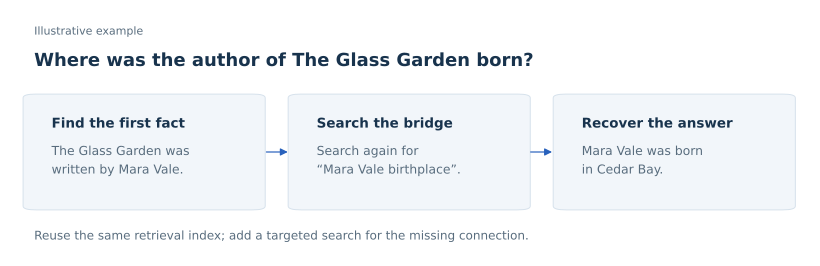
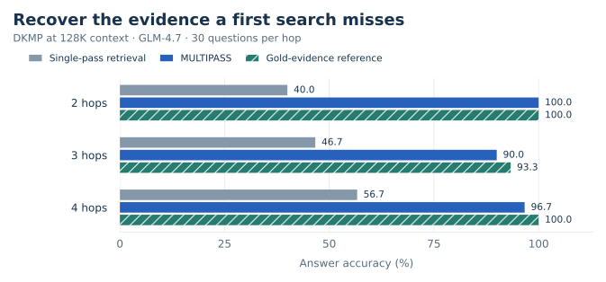

<div align="center">
  <a href="https://icml.cc/Conferences/2026"></a>
  <h1>MULTIPASS</h1>
  <p><strong>Follow the missing link in long-context retrieval.</strong></p>
  <a href="https://icml.cc/Conferences/2026"></a>
  <p>Bounded multi-hop retrieval for long-context and agent memory</p>
  <p>
    <a href="#the-idea">The idea</a> ·
    <a href="#what-you-can-do">What you can do</a> ·
    <a href="#results">Results</a> ·
    <a href="#get-started">Get started</a> ·
    <a href="#repository-guide">Repository guide</a>
  </p>
</div>

**MULTIPASS uses a fact found in one search to guide the next search.** It repairs
missing evidence chains with short bridge-entity queries, reusing the same
retriever and index without a graph or retraining. **DKMP**, the companion stress
test, makes this failure reproducible in long contexts.

<p align="center">
  
</p>

## The idea

**Question:** “Where was the author of *The Glass Garden* born?”

| First fact | Missing link | Answer-bearing fact |
|---|---|---|
| *The Glass Garden* was written by **Mara Vale**. | Search again for **Mara Vale**. | Mara Vale was born in **Cedar Bay**. |

*Illustrative example; names and facts are fictional.*

A single search may find the book's author but miss the birthplace: the author's
name was absent from the original question. We call this **bridge starvation**.
MULTIPASS asks the LLM for a short bridge entity (≤ 6 words), searches with it,
and gives the reader the combined evidence. Retrieval is bounded by a pass limit;
`NONE` signals that no further bridge lookup is needed.

## What you can do

- **Stress-test a retriever.** Use DKMP's synthetic fact chains in real NarrativeQA
  distractors to measure failures as context length and hop depth increase.
- **Adapt the repair to a RAG or agent-memory loop.** Reuse the bridge prompts,
  retrieval passes, and evidence merging in the [MULTIPASS scripts](scripts/dkmp/).
- **Find the failing stage.** Inspect bridge queries, retrieved evidence, needle
  recall, and judged answers to separate missing evidence from reader errors.
- **Compare against released runs.** Explore [DKMP](results/dkmp/),
  [LongMemEval](results/longmemeval/), and [LongBench v2](results/longbench_v2/)
  outputs before running an experiment.

## Results

**At 128K tokens, MULTIPASS recovers much of the accuracy lost to bridge starvation.**

<p align="center">
  
</p>

| Hops | Single-pass Hybrid-RRF | MULTIPASS | Oracle (gold needles) |
|----:|:----------------------:|:---------:|:---------------------:|
| 2 | 0.40 | **1.00** | 1.00 |
| 3 | 0.47 | **0.90** | 0.93 |
| 4 | 0.57 | **0.97** | 1.00 |
| 5† | 0.13 | 0.53 | 0.76 |

GLM-4.7 reader and fresh-call YES/NO judge; **30 items per cell** for 2–4 hops.
Retrieval methods share the reader and index; reader-token budgets differ.
The oracle receives gold evidence rather than retrieving it.

The 2–4-hop values come from the frozen [released grid](https://github.com/ArthurQQQQ/multipass-multihop-retrieval-ICMLW/blob/8cd5262f3e66e6051858de485e36e38947daa1c6/results/dkmp/L90_grid_v2.json)
(`K6/K7/K8`; `M3/M7/M5`). MULTIPASS matches the oracle on 2-hop and trails it by
one answer out of 30 on 3- and 4-hop. †The 5-hop row is retained from the
[original README](https://github.com/ArthurQQQQ/multipass-multihop-retrieval-ICMLW/blob/8cd5262f3e66e6051858de485e36e38947daa1c6/README.md);
it is not included in the released grid plotted above.

**A bounded repair.** The original release reports that it does not solve 5-hop
chains, does not help on short-context MuSiQue where the trigger does not fire,
and does not target LongMemEval's cross-session aggregation failure.

## Get started

**Start with the released results: no API key, dataset download, or model setup needed.**
Browse the [accuracy grid](results/dkmp/L90_grid_v2.json),
[predictions](results/dkmp/predicted_v0.jsonl), and
[judged answers](results/dkmp/scored_v0.jsonl) directly on GitHub.

To run the research scripts, clone the repository and install the dependencies:

```bash
git clone https://github.com/ArthurQQQQ/multipass-multihop-retrieval-ICMLW.git
cd multipass-multihop-retrieval-ICMLW
python -m venv .venv
source .venv/bin/activate
python -m pip install -r requirements.txt
cp .env.example .env
```

Edit `.env` with your `GLM_API_KEY`, `GLM_URL`, and `GLM_MODEL`, then export them
in the same shell before running scripts:

```bash
set -a
. ./.env
set +a
```

The reader, bridge calls, and judge use a GLM-4.7 HTTP API; BGE-M3 embeddings run
locally on MPS, CUDA, or CPU. Exporting variables works for both DKMP and
LongMemEval (the DKMP helper also reads `.env.local`).

### Prepare DKMP data

`data/` is intentionally empty. Copy the released probe definitions into the
paths expected by the scripts:

```bash
mkdir -p data/dkmp
cp results/dkmp/needles_v0.jsonl data/dkmp/needles_v0.jsonl
cp results/dkmp/stories_v0.json data/dkmp/stories_v0.json
```

Obtain NarrativeQA source texts separately and place each selected story at
`data/narrativeqa/full_text/<story_id>.txt` before building contexts. IDs are in
`stories_v0.json`, which contains metadata rather than story texts.

```bash
python scripts/dkmp/02_build_contexts.py
python scripts/dkmp/00_cache_embeddings.py
```

These create `contexts_v0.jsonl`, `chunks_cache_v0.jsonl`, and the BGE-M3
`embeddings_cache_v0.npz` under `data/dkmp/` (the original release reports an
embedding cache of about 386 MB).

### Run retrieval and evaluation

```bash
python scripts/dkmp/03_run_baselines.py         # FullCtx / dense / BM25 / Hybrid-RRF / oracle
python scripts/dkmp/03c_run_multipass_cached.py # M6: two retrieval passes, one bridge
python scripts/dkmp/03f_run_M7_cached.py        # M7: three retrieval passes, two bridges; K7 by default
python scripts/dkmp/04_judge.py                # fresh-call GLM-4.7 YES/NO judge
python scripts/dkmp/05_compute_L90.py          # accuracy grid + bootstrap CIs
```

Outputs are written under `data/dkmp/`; released outputs stay in `results/dkmp/`.
The iterative variant is [03e_run_iter_multipass.py](scripts/dkmp/03e_run_iter_multipass.py),
which exposes `--max_hops`. It and the three-pass script both write method `M7`;
choose one M7 variant per prediction file to keep their results separate.

<details>
<summary><strong>LongMemEval: full N=500 same-reader check</strong></summary>

Obtain the source dataset separately and prepare
`data/longmemeval/cleaned/longmemeval_oracle.json` in the session format consumed by
[the evaluator](scripts/longmemeval_eval_methods.py). The released repository does
not include this input or a full data-preparation pipeline.

```bash
python scripts/longmemeval_eval_methods.py --method hybrid_rrf --per-type 0 --char-budget 8000 --K 10 --out-name full_n500
python scripts/longmemeval_llm_judge.py --method hybrid_rrf --out-name full_n500
```

`--per-type 0` selects all input items; the default samples eight per type.
LongBench v2 source data is also not redistributed; see its scripts for expected
local inputs.

</details>

## Repository guide

```text
scripts/
  dkmp/                 DKMP context, retrieval, bridge, and evaluation pipeline
  longmemeval_*.py       LongMemEval same-reader evaluation
  lb2_* / *_lb2.py       LongBench v2 multipass extraction and evaluation
results/
  dkmp/                 released probes, predictions, judged answers, and L90 grids
  longmemeval/           eval_* and judged_* outputs for N=500
  longbench_v2/          multipass scored outputs
data/                   local source corpora, generated contexts, caches, and new runs
```

<details>
<summary><strong>DKMP pipeline and reproducibility notes</strong></summary>

DKMP embeds synthetic-entity fact chains in NarrativeQA distractors at
**1K, 8K, 32K, and 128K tokens**. The original release describes probes up to
5 hops; the released `L90_grid_v2.json` contains the 2–4-hop chain cells shown above.

| Script in `scripts/dkmp/` | Purpose |
|---|---|
| `01_generate_needles.py` | Generate and validate synthetic probe facts and questions |
| `02_build_contexts.py` | Insert released probes into distractor contexts |
| `00_cache_embeddings.py` | Cache BGE-M3 chunk embeddings |
| `03_run_baselines.py` | FullCtx, dense, BM25, Hybrid-RRF, and oracle baselines |
| `03c_run_multipass_cached.py` | M6: two passes, one bridge |
| `03f_run_M7_cached.py` | M7: three passes, two bridges |
| `03e_run_iter_multipass.py` | M7 iterative variant with a configurable pass bound |
| `04_judge.py` | Fresh-call GLM-4.7 YES/NO judge |
| `05_compute_L90.py` | Accuracy grid, L90, and bootstrap confidence intervals |

- **Retrieval:** BGE-M3 dense retrieval + BM25, fused with reciprocal rank fusion.
  Bridge passes reuse that index and merge retrieved chunks before the final reader call.
- **Scoring:** LLM-judge accuracy, with a YES/NO judge prompt separate from the
  reader prompt. See the [frozen judge implementation](https://github.com/ArthurQQQQ/multipass-multihop-retrieval-ICMLW/blob/8cd5262f3e66e6051858de485e36e38947daa1c6/scripts/dkmp/04_judge.py).
- **Confidence intervals:** the original release reports 10,000 bootstrap
  resamples, seed 42. The current script defaults to 1,000 and does not pass its
  `--n_boot` flag through to the computation; these are distinct reported settings.
- **Additional reported comparisons:** the original README reports results above
  IRCoT, ReAct, Self-Ask, and passage-graph PPR under the same reader and index;
  those methods are not in the released `L90_grid_v2.json` comparison.
- **Compute:** the original release reports about 12 hours on one laptop, using
  M-series MPS for BGE-M3 embeddings; runtime depends on hardware and API throughput.

</details>

From *“Bridge Starvation: A Reproducible Failure Mode of Single-Pass Memory
Retrieval, with a Bounded Repair”* (ICML 2026 workshop).

[MIT License](LICENSE) · [Citation metadata](CITATION.cff)
